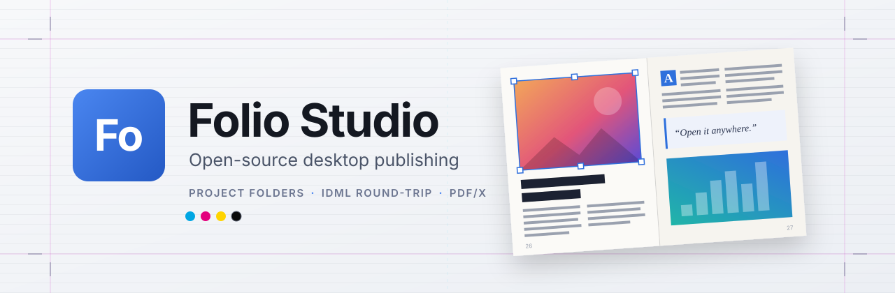
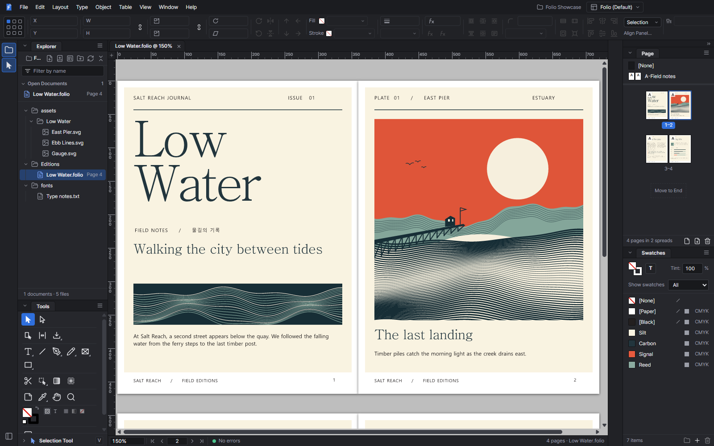
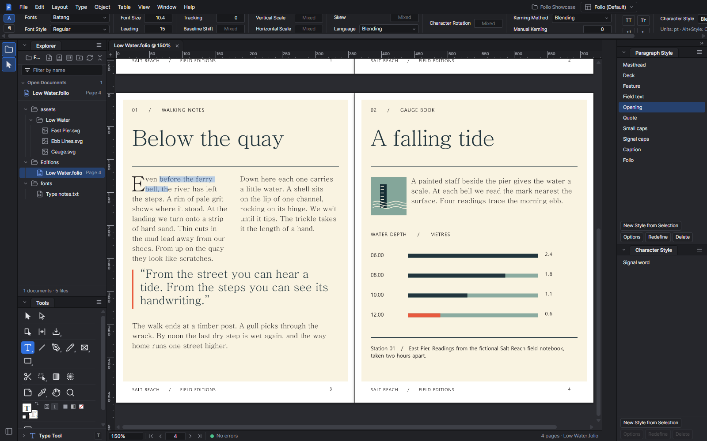
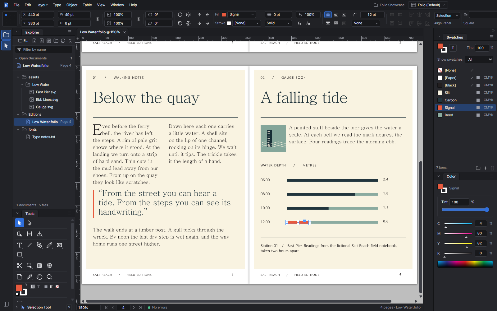
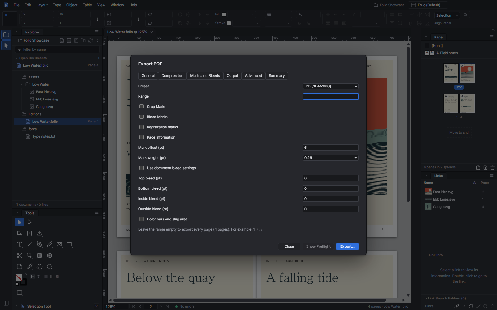
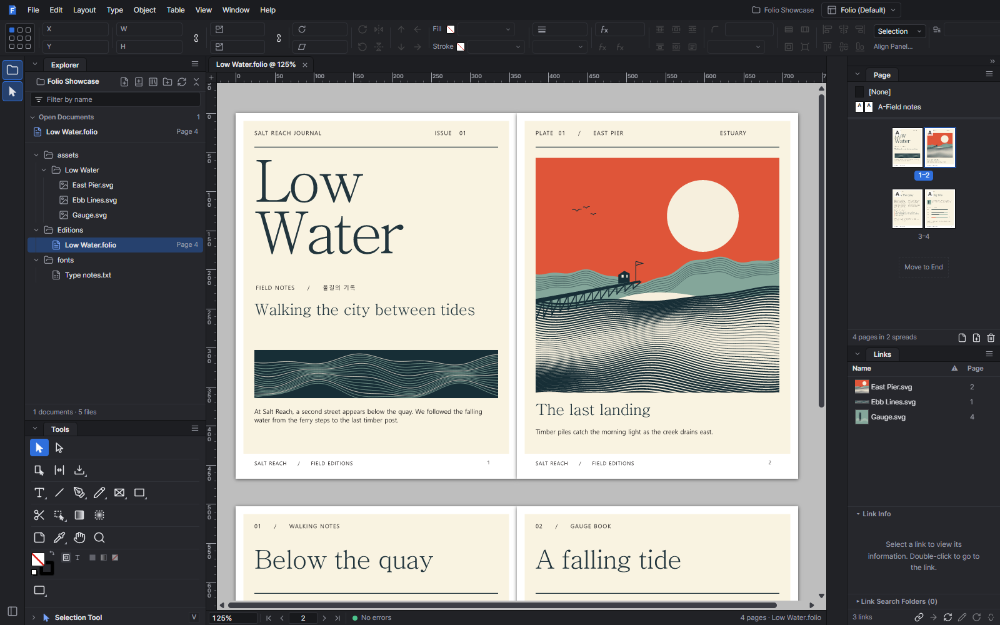
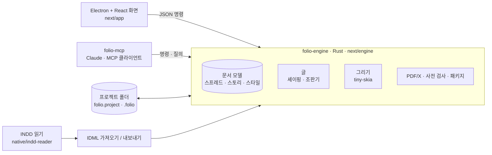

<p align="center">
  <picture>
    <source media="(prefers-color-scheme: dark)" srcset="docs/assets/banner-dark.svg">
    
  </picture>
</p>

<p align="center">
  <b>잡지·신문·책을 어디서든 열리는 프로젝트 폴더 하나로 만듭니다.</b><br>
  InDesign 문서를 잃지 않고 가져와 편집하고, 인쇄소에는 깨끗한 PDF/X 로 넘깁니다.
</p>

<p align="center">
  <a href="LICENSE"></a>
  
  
  
  
  
</p>

<p align="center">
  <a href="#-내려받기"><b>내려받기</b></a> ·
  <a href="#-기능"><b>기능</b></a> ·
  <a href="#-소스로-빌드"><b>빌드</b></a> ·
  <a href="#-구조"><b>구조</b></a> ·
  <a href="README.md"><b>English</b></a>
</p>

<p align="center">
  <picture>
    <source media="(prefers-color-scheme: light)" srcset="docs/assets/screenshots/light-hero.png">
    
  </picture>
</p>

## 💡 왜 Folio 인가

인쇄 디자인은 아직도 수십 년 전에 설계된 문서 형식 위에서 돌아갑니다. 링크한 그림은 절대 경로로 저장돼서, 폴더를 다른 드라이브나 NAS,
다른 운영체제로 옮기는 순간 링크가 끊깁니다. 어떤 그림은 문서 안에, 어떤 그림은 밖에 있고, 글꼴은 아예 들어가지 않습니다.
이것을 정리하는 방법은 '패키지'로 모든 것을 또 다른 폴더에 복사하는 것뿐입니다.

**Folio Studio 는 반대쪽에서 시작합니다. 프로젝트 폴더가 곧 문서입니다.** 레이아웃이 쓰는 모든 것이 폴더 하나 안에 있고, 프로젝트
기준 상대 경로와 내용 해시로 기억됩니다. 폴더를 통째로 다른 드라이브, NAS, 맥, 윈도우, 리눅스로 옮겨도 다시 이을 것 없이 그대로 열립니다.
그러면서도 업계의 언어를 씁니다. INDD·IDML 을 가져오고 IDML 로 내보내니, 지금까지의 작업을 그대로 가져올 수 있습니다.

## ✨ 기능

<table>
  <tr>
    <td width="33%" valign="top">
      <h3>📁 프로젝트 폴더</h3>
      모든 링크·그림·글꼴을 프로젝트 기준 상대 경로와 SHA-256 해시로 저장합니다. 폴더를 어디로 옮겨도 열립니다.
      잠금 파일과 원자적 저장으로 NAS 공유 폴더에서도 안전합니다.
    </td>
    <td width="33%" valign="top">
      <h3>🔁 InDesign 왕복</h3>
      INDD·IDML 을 가져오고 IDML 로 내보냅니다. 아직 이해하지 못하는 것은 원문 그대로 들고 있다가 다시 씁니다.
      가져오기·내보내기 보고서가 무엇이 달라지는지 정확히 알려 줍니다.
    </td>
    <td width="33%" valign="top">
      <h3>🖨️ 인쇄 출력</h3>
      투명도 병합을 포함한 PDF/X-4·X-1a·X-3, 사전 검사, 분판 미리보기, 내 컴퓨터에 설치된 ICC 프로파일로 하는 화면 교정,
      인쇄소용 패키지까지 한 번에.
    </td>
  </tr>
  <tr>
    <td width="33%" valign="top">
      <h3>✒️ 제대로 된 조판</h3>
      단락 조판기, 하이픈 넣기, 시각적 커닝과 시각적 여백 정렬, 한글 조판, 각주·미주, 표, 패스 위 글자, MathML 수식,
      색인, 책, 상호 참조, 데이터 병합.
    </td>
    <td width="33%" valign="top">
      <h3>🤖 MCP 로 AI 와 함께</h3>
      화면에서 하는 모든 일이 엔진 명령으로도 됩니다. 내장 <code>folio-mcp</code> 서버로 Claude 나 다른 MCP 클라이언트가
      실행 중인 Folio 를 조작합니다. 켜 준 권한 안에서만.
    </td>
    <td width="33%" valign="top">
      <h3>🦀 진짜 엔진</h3>
      문서 처리는 전부 Rust 엔진이 하고, 엔진은 라이브러리로도 쓸 수 있습니다. Electron + React 화면은 엔진이 그린 것을 보여 줍니다.
      오늘은 데스크톱에서, 나중에는 태블릿에서도.
    </td>
  </tr>
</table>

## 📸 화면

<table>
  <tr>
    <td width="50%"><br><sub><b>조판</b> — 스타일·조판기·하이픈을 페이지 위에서 바로.</sub></td>
    <td width="50%"><br><sub><b>색</b> — 색 견본, 분판 미리보기, 화면 교정.</sub></td>
  </tr>
  <tr>
    <td width="50%"><br><sub><b>출력</b> — PDF/X 내보내기, 사전 검사, 패키지.</sub></td>
    <td width="50%"><br><sub><b>프로젝트</b> — 문서·그림·글꼴을 옮길 수 있는 폴더 하나에.</sub></td>
  </tr>
</table>

## ⬇️ 내려받기

**Windows**(x64)와 **macOS**(Apple Silicon)용 앱은 [Releases](../../releases) 에 있습니다. 압축을 풀고 `Folio Studio` 를 실행합니다.
리눅스는 [소스로 빌드](#-소스로-빌드)합니다.

> [!NOTE]
> 아직 코드 서명을 하지 않았습니다. 처음 실행할 때 Windows SmartScreen 과 macOS Gatekeeper 가 한 번 묻습니다.
> macOS 판은 교차 빌드한 것이라 아직 실제 맥에서 돌려 보지 못했습니다. 써 보시고 알려 주시면 큰 도움이 됩니다.

**견본 열어 보기:** [`samples/low-water`](samples/low-water) 폴더를 **파일 ▸ 프로젝트 열기**로 열면 화면 속 잡지를 직접 볼 수 있습니다.
Windows 에 들어 있는 바탕·맑은 고딕 글꼴을 쓰며, 다른 운영체제에서는 비슷한 글꼴로 바꿔 보여 줍니다.

## 🛠 소스로 빌드

**Rust**(stable, edition 2024), **Node.js 22**, **Python 3.12**(패키지·검사 도구용)가 필요합니다.

```sh
git clone --recursive https://github.com/linerec/FolioStudio.git
cd FolioStudio/next/app
npm ci              # 화면 의존성
npm run build       # Rust 엔진(release) + 화면
npx electron .      # 실행
```

혼자 도는 앱으로 묶기:

```sh
python next/tools/package-app.py windows     # 또는 mac
```

고친 크레이트의 시험 돌리기:

```sh
cd next/engine
cargo test -p folio-model        # model, text, render, pdf, idml, project, ...
```

## 🧠 구조



- **문서는 엔진이 가진다.** 화면은 명령을 보내고 엔진이 그린 페이지를 보여 줍니다. 그래서 같은 명령을 스크립트나 LLM 도 보낼 수 있습니다.
- **`.folio` 는 IDML 의 상위 집합이다.** `.folio` 파일은 IDML 패키지에 모든 참조 파일의 목록(경로·해시·크기)을 더한 것입니다.
  Folio 전용 기능은 IDML 스크립트 레이블에 실려서 다른 IDML 도구를 거쳐도 남습니다.
- **말없이 잃는 것이 없다.** 모델의 모든 항목은 정확·근사·Folio 전용 가운데 하나로 등록되고, 등록되지 않은 항목이 있으면 시험이 실패합니다.

## 🗂 저장소 구성

```text
next/engine/crates/   model · text · render · pdf · idml · project · edit · server
                      preflight · package · color · links · spell · math · dbsource · textimport
next/app/             Electron 셸과 React 화면
next/oracle/          시험이 비교하는 기준 사례
native/compose/       줄바꿈과 간격
native/indd-reader/   INDD 읽기(원본은 읽기만 하고 쓰지 않음)
third_party/          INDD 가져오기가 쓰는 포크한 읽기 라이브러리
```

## 🧭 상태

Folio Studio 는 초기 **알파**(0.1)입니다. 가져오기, 편집, 조판, 색, PDF/X 출력까지 많은 것이 처음부터 끝까지 동작하지만,
1.0 전까지는 거친 곳과 형식 변경이 있을 수 있습니다. 아직 지원하지 않는 기능은 앱의 **도움말**에 모여 있습니다.

## 🤝 기여

이슈와 풀 리퀘스트를 환영합니다. 큰 변경은 먼저 이슈로 이야기해 주세요.
엔진 코드를 고치면 고친 크레이트(와 그것에 기대는 크레이트)의 시험을 돌려 주세요.

## 📄 라이선스

Folio Studio 는 [Apache License 2.0](LICENSE) 으로 배포합니다. 함께 넣은 사전·하이픈 패턴·글꼴·아이콘은 각자의 라이선스를
따릅니다. 자세한 것은 [NOTICE](NOTICE) 에 있습니다.

<sub>InDesign 은 Adobe Inc. 의 상표입니다. Folio Studio 는 독립 프로젝트이며 Adobe 와 관계가 없고 Adobe 의 보증을 받지 않았습니다.</sub>

<p align="center"><sub>고쳐 보고 싶었던 잡지 디자이너가 만들었습니다. ✍️</sub></p>
