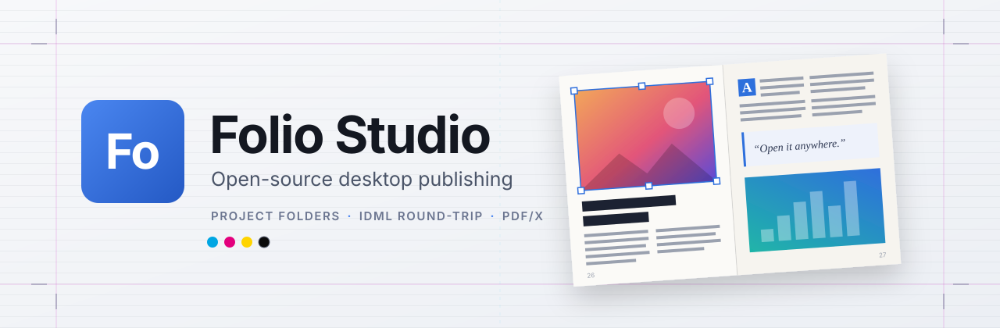
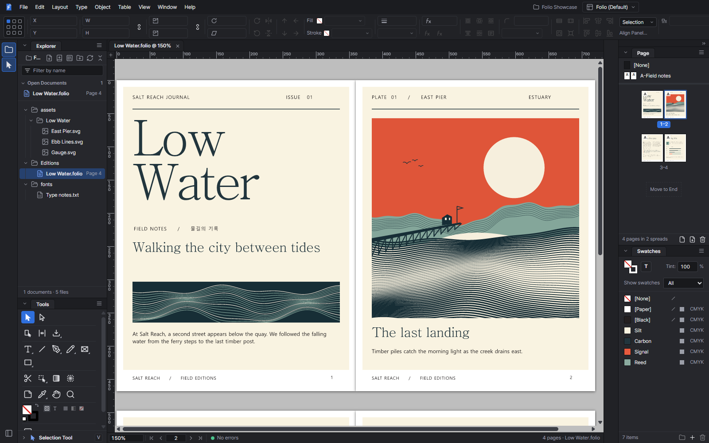
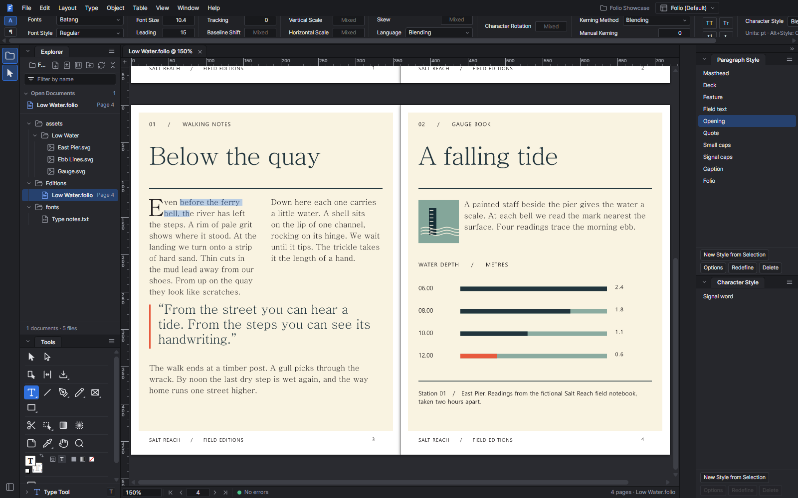
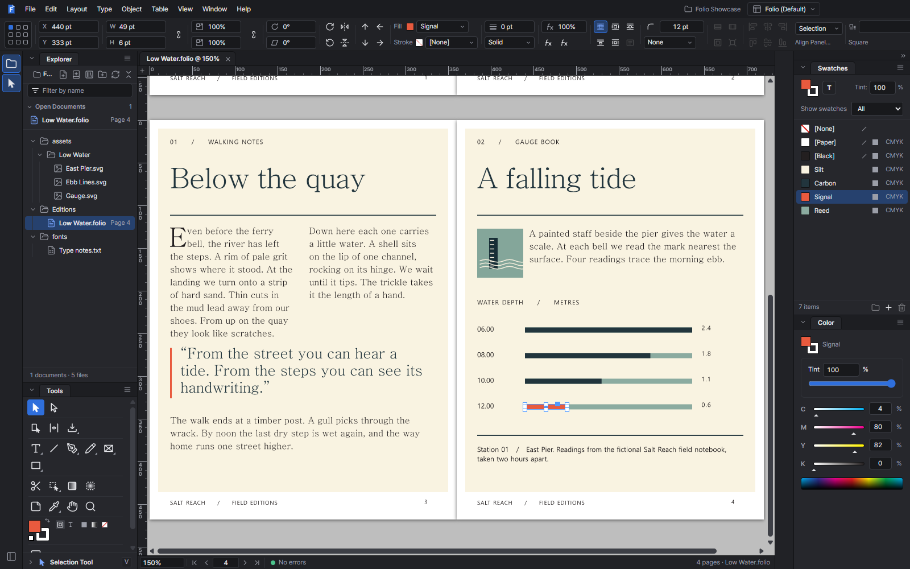
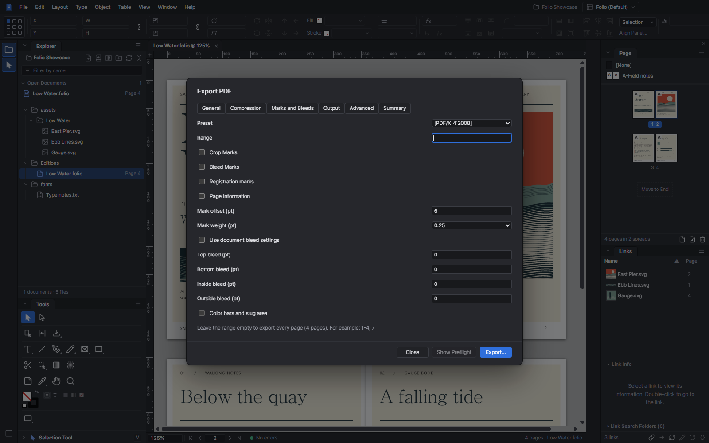
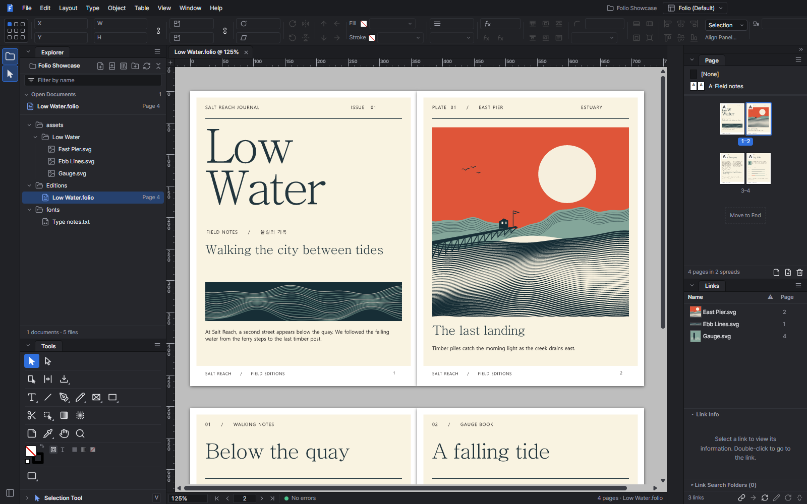
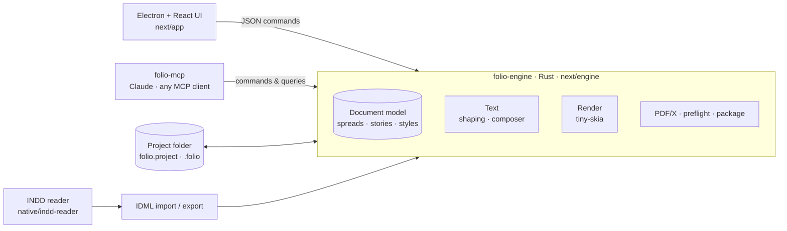

<p align="center">
  <picture>
    <source media="(prefers-color-scheme: dark)" srcset="docs/assets/banner-dark.svg">
    
  </picture>
</p>

<p align="center">
  <b>Lay out magazines, newspapers and books in a project folder that opens anywhere.</b><br>
  Bring in InDesign documents without losing anything, edit them, and hand the printer a clean PDF/X.
</p>

<p align="center">
  <a href="https://github.com/linerec/FolioStudio/actions/workflows/ci.yml"></a>
  <a href="LICENSE"></a>
  
  
  
  
  
</p>

<p align="center">
  <a href="#-download"><b>Download</b></a> ·
  <a href="#-features"><b>Features</b></a> ·
  <a href="#-build-from-source"><b>Build</b></a> ·
  <a href="#-how-it-works"><b>How it works</b></a> ·
  <a href="README.ko.md"><b>한국어</b></a>
</p>

<p align="center">
  <picture>
    <source media="(prefers-color-scheme: light)" srcset="docs/assets/screenshots/light-hero.png">
    
  </picture>
</p>

## 💡 Why Folio

Print design still runs on document formats that were designed decades ago. Linked pictures are stored as absolute paths, so a layout breaks
the moment its folder moves to another drive, a NAS, or the other operating system. Some pictures live inside the document, some outside,
fonts not at all — and the only way to tidy it up is to "package" everything into yet another folder.

**Folio Studio starts from the other end: the project folder is the document.** Everything a layout uses lives in one folder and is
referenced by a relative path and a content hash. Copy the whole folder to another drive, a NAS, a Mac, a Windows PC or a Linux box and it
opens as it is — nothing to relink. Folio still speaks the industry's language: it imports INDD and IDML and exports IDML, so the work
you already have comes with you.

## ✨ Features

<table>
  <tr>
    <td width="33%" valign="top">
      <h3>📁 Project folders</h3>
      Every link, picture and font is stored with a project-relative path and a SHA-256 hash. Move the folder anywhere and it still opens.
      Lock files and atomic saves keep folders on a NAS safe for a team.
    </td>
    <td width="33%" valign="top">
      <h3>🔁 InDesign round-trip</h3>
      Imports INDD and IDML, exports IDML. Anything Folio doesn't understand yet is kept verbatim and written back out.
      Import and export reports say exactly what will change.
    </td>
    <td width="33%" valign="top">
      <h3>🖨️ Print-ready output</h3>
      PDF/X-4, X-1a and X-3 with transparency flattening, preflight, separations preview, soft proofing with the ICC profiles installed on
      your computer, and one-step packaging for the printer.
    </td>
  </tr>
  <tr>
    <td width="33%" valign="top">
      <h3>✒️ Serious typography</h3>
      Paragraph composer, hyphenation, optical kerning and margin alignment, Korean typesetting, footnotes and endnotes, tables,
      text on a path, MathML equations, indexes, books, cross-references and data merge.
    </td>
    <td width="33%" valign="top">
      <h3>🤖 AI over MCP</h3>
      With your permission, an AI can read the open document, edit text, styles, objects and pages, and produce publication files. Saving and exporting require separate permission.
      Automated checks counted 412 tools on the connected server and completed 10 publishing workflows.
    </td>
    <td width="33%" valign="top">
      <h3>🦀 A real engine</h3>
      All document logic lives in a Rust engine that also works as a library; the Electron + React UI shows what the engine draws.
      Built to run on desktops today and on tablets later.
    </td>
  </tr>
</table>

## 📸 Screenshots

<table>
  <tr>
    <td width="50%"><br><sub><b>Typography</b> — styles, composer and hyphenation, live on the page.</sub></td>
    <td width="50%"><br><sub><b>Color</b> — swatches, separations preview and soft proofing.</sub></td>
  </tr>
  <tr>
    <td width="50%"><br><sub><b>Output</b> — PDF/X export, preflight and packaging.</sub></td>
    <td width="50%"><br><sub><b>Projects</b> — documents, pictures and fonts in one portable folder.</sub></td>
  </tr>
</table>

## ⬇️ Download

Pre-built apps for **Windows** (x64) and **macOS** (Apple Silicon) are on the [Releases](../../releases) page — unzip and run
`Folio Studio`. On Linux, [build from source](#-build-from-source).

> [!NOTE]
> The builds are not code-signed yet. Windows SmartScreen and macOS Gatekeeper will ask before the first launch.
> The macOS build is cross-compiled and hasn't been tried on a real Mac yet — reports are very welcome.

**Try the sample:** open the [`samples/low-water`](samples/low-water) folder with **File ▸ Open Project** to explore the magazine from the
screenshots. It uses the Batang and Malgun Gothic fonts that come with Windows; other systems substitute them.

Explore the 51-page [Feature Atlas](samples/feature-atlas) with **Help ▸ Open Feature Sample (Atlas)**. It contains 181 examples in 29 groups.

Open **Help ▸ Open Magazine Sample** to edit [Riverbend Letters](samples/riverbend-letters), a 20-page Korean monthly following a market day in a fictional river town.


## 🤖 Connect an AI (MCP)

The Windows and Apple Silicon downloads include the `folio-mcp` server. On Windows, unzip the app, open a project and leave Folio running.

1. In **Preferences ▸ General**, turn on **Allow LLM connection (MCP)**. All three MCP switches start off. Enable **LLM may write files** if you want the client to save or export. Enable **LLM may refresh database sources** if it needs to refresh data from a database you unlocked in Folio. Enter passwords in Folio itself. MCP has no password or printer access.
2. For **Claude Code**, replace `<app folder>` with the folder containing `Folio Studio.exe` and run:

   ```sh
   claude mcp add --transport stdio folio -- "<app folder>/resources/folio-mcp.exe" --attach
   ```

   For **Claude Desktop**, add this entry to `mcpServers` in its configuration, using your actual path, then restart Claude Desktop:

   ```json
   {
     "mcpServers": {
       "folio": {
         "command": "C:/Apps/Folio Studio/resources/folio-mcp.exe",
         "args": ["--attach"]
       }
     }
   }
   ```

3. Ask the client to call `appConnection` and check for `attached: true`. In this state, the Windows release advertised 412 tools. Call `coverage` and read `attached` for the available commands, required permissions and reasons other commands are withheld. If the connection was off when the client started, turn it on in Folio and restart the MCP server.

The Mac executable is at `Folio Studio.app/Contents/Resources/folio-mcp`. Linux requires a source build. The connection has been tested on Windows. macOS and Linux still need testing on those systems.

### What an AI can do

MCP supported means that all 99 read queries and all 9 core editing groups are available, and all 10 publishing workflows pass end to end using MCP tools alone.

Of 398 registered commands, 343 are available and 55 are intentionally withheld. These cover data outside the project (32), engine process control (12), passwords and secrets (6), printers (4) and one drag-only action. Call `coverage` for the reason behind each entry.

| Workflow | Windows release |
|---|---|
| Lay out a four-page magazine from a manuscript and three images | Passed |
| Import IDML and fix overset text | Passed |
| Apply a body paragraph style throughout a document | Passed |
| Relink a placed image to its replacement | Passed |
| Fix an issue found by preflight | Passed |
| Export a PDF/X-4 file and verify it | Passed |
| Merge CSV records into two business cards | Passed |
| Replace text with a translation and preserve formatting | Passed |
| Check a table of contents, an index and page numbers | Passed |
| Package the document, links and report for a print shop | Passed |

[Steps and results for each workflow](docs/releases/v0.2.0-alpha.md)

## 🛠 Build from source

You need **Rust** (stable, edition 2024), **Node.js 22** and **Python 3.12** (for the packaging and check tools).

```sh
git clone --recursive https://github.com/linerec/FolioStudio.git
cd FolioStudio/next/app
npm ci              # UI dependencies
npm run build       # Rust engine (release) + UI
npx electron .      # run
```

Package a standalone app:

```sh
python next/tools/package-app.py windows     # or: mac
```

Run the engine tests for the crate you are working on:

```sh
cd next/engine
cargo test -p folio-model        # model, text, render, pdf, idml, project, ...
```

## 🧠 How it works



- **The engine owns the document.** The UI sends commands and draws the pages the engine renders, so the same commands can come from a
  script or an LLM.
- **`.folio` is a superset of IDML.** A `.folio` file is an IDML package plus a manifest of every referenced file (path, hash, size).
  Folio-only features travel inside IDML script labels, so they survive a trip through other IDML tools.
- **Nothing is lost silently.** Every model feature is registered as exact, approximate or Folio-only, and tests fail when one isn't.

## 🗂 Repository layout

```text
next/engine/crates/   model · text · render · pdf · idml · project · edit · server
                      preflight · package · color · links · spell · math · dbsource · textimport
next/app/             Electron shell and React UI
next/oracle/          reference cases the tests compare against
native/compose/       line breaking and spacing
native/indd-reader/   INDD reader (reads only, never writes the original)
third_party/          forked readers used by the INDD importer
```

## 🧭 Status

Folio Studio is an early **alpha** (0.2). A lot works end to end — import, editing, typography, color and PDF/X output — but expect
rough edges and format changes before 1.0. Features that aren't supported yet are listed in the app under **Help**.

## 🤝 Contributing

Issues and pull requests are welcome. For a larger change, please open an issue first so we can talk it through.
When you change engine code, run the tests of the crates you touched (and the ones that depend on them).

## 📄 License

Folio Studio is licensed under the [Apache License 2.0](LICENSE). Bundled dictionaries, hyphenation patterns, fonts and icons
keep their own licenses — see [NOTICE](NOTICE).

<sub>InDesign is a trademark of Adobe Inc. Folio Studio is an independent project and is not affiliated with or endorsed by Adobe.</sub>

<p align="center"><sub>Made by a magazine designer who wanted to fix things. ✍️</sub></p>
