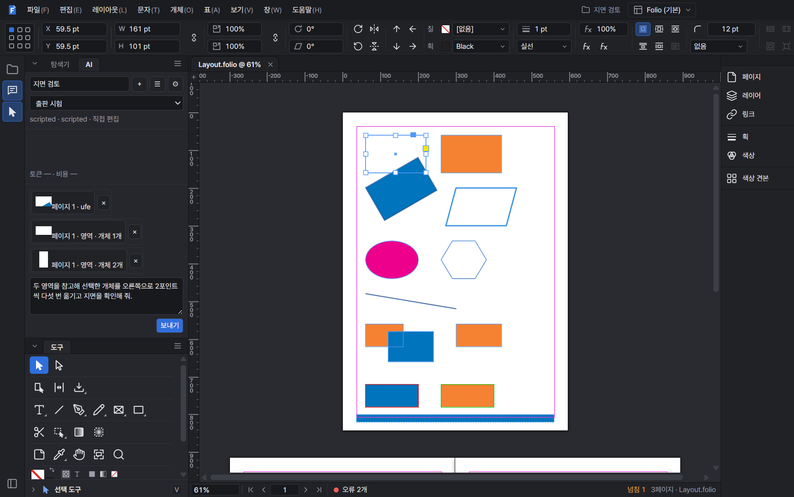

# Folio Studio 0.2.1-alpha — AI chat and samples

## What's new

### AI chat

Open **AI** in the left sidebar to ask a question about a layout or request an edit. Select objects or text and press **Ctrl+L** (**⌘L** on Mac) to attach them. To point to part of a page, press **Shift+Q** and drag a rectangle. Hold Shift to add another region.

Choose **Set up AI** to configure your own Claude API key, an OpenAI-compatible endpoint (including a local model), or an installed Claude Code, Codex or Gemini CLI agent through ACP. Folio sends nothing to an AI service before you set up a connection. Saved API keys use OS-backed secure storage. If it is unavailable, a key lasts only for the current run. Conversation history stays in Folio’s user data folder, separate from the project you share.

Choose whether the AI can only answer questions, must ask before editing, or can edit directly. File writes always require permission. Each request groups its document edits into one undo step per document. Use the change card to keep the edits, undo that turn, or restore the document to the point before a turn.

*“scripted” is the test connection used for this screenshot.*

### Editable samples

Both downloads include two editable samples. Open a sample card on the start screen, in the empty Explorer, on the project home screen or in the AI panel when no document is open. The same samples are available from Help. Folio Studio creates a working copy under `Documents/Folio Studio`.

- **Help ▸ Open Feature Sample (Atlas)** imports a 51-page IDML document with 181 layout examples in 29 groups. The working copy is `Feature Atlas/Feature_Atlas.folio`.
- **Help ▸ Open Magazine Sample** opens *Riverbend Letters* (물굽이 서간), a 20-page Korean magazine about market day in a fictional river town. Its articles, illustrations, advertisements and classified listings are editable in `riverbend-letters/november.folio`.

## Downloads

| Archive | Bytes | SHA-256 |
|---|---:|---|
| `FolioStudio-0.2.1-alpha-windows-x64.zip` | 209,184,233 | `4d95d1a3c44ec4eef21fdb77088d72c30094d7b005b6024cc87fb1e8e3bef68b` |
| `FolioStudio-0.2.1-alpha-macos-arm64.zip` | 178,196,236 | `384f376926bf6c2b35e7137ecda4a9e63beab0ad062cf257f4daf6686c0d97c3` |

## Known limitations

The AI panel was tested on Windows with a scripted provider and a simulated ACP agent. Conversations with the live Claude API, local models and real Claude Code, Codex or Gemini CLI agents have not been verified. The AI panel has not been tested on a Mac.

On Windows, a test comparing incremental IDML document updates with full reads terminated with an access violation. The cause is unknown.

The MCP limits documented for 0.2.0-alpha still apply. Withheld operations include access outside the project, engine process control, passwords and secrets, printers and a drag-only action. Call `coverage` for the reason for each entry.

MCP access starts off. Enable it in Preferences. File writes and database refresh each require separate permission.

The Windows app has no publisher signature. The Apple Silicon macOS app is ad-hoc signed and has not been notarized. The previous release's live MCP connection test ran on Windows. Linux users can build from source.

## 한국어

왼쪽 AI 대화창에서 개체·글·영역을 골라 문서 작업을 요청하고, 한 질문으로 바뀐 내용을 한 번에 되돌릴 수 있습니다. 직접 연결을 설정하기 전에는 AI 서비스에 아무것도 보내지 않습니다. AI 대화는 Windows에서 대본과 모의 에이전트로 시험했고 실제 서비스·로컬 모델·CLI와 맥 AI 화면은 확인하지 않았습니다. 시작 화면이나 탐색기, AI 패널의 샘플 카드에서 51쪽의 기능 표본(181개 예시)과 20쪽 잡지 《물굽이 서간》을 열어 편집할 수 있습니다.
